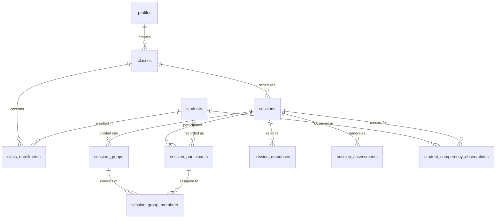

# Teach Easy — Data Model Specification

### 1. Entity Relationship Overview

---

### 2. Table Schemas & Foreign Keys

#### `profiles`
Represents the authenticated teacher profile.
- `id` (UUID, PK, references `auth.users(id)` ON DELETE CASCADE)
- `full_name` (TEXT, NOT NULL)
- `school_name` (TEXT)
- `created_at` (TIMESTAMPTZ, default `now()`)
- `updated_at` (TIMESTAMPTZ, default `now()`)

#### `classes`
Classroom groups managed by a teacher (e.g. "2/1 علمي - أحياء").
- `id` (UUID, PK, default `gen_random_uuid()`)
- `teacher_id` (UUID, NOT NULL, references `profiles(id)` ON DELETE CASCADE)
- `name` (TEXT, NOT NULL)
- `subject` (TEXT, NOT NULL)
- `grade_level` (TEXT, NOT NULL) -- 10, 11, or 12
- `academic_year` (TEXT, default '2026/2027')
- `is_archived` (BOOLEAN, default false)
- `created_at` (TIMESTAMPTZ, default `now()`)
- `updated_at` (TIMESTAMPTZ, default `now()`)

#### `students`
Student records managed by the teacher. Contains strictly minimal PII.
- `id` (UUID, PK, default `gen_random_uuid()`)
- `teacher_id` (UUID, NOT NULL, references `profiles(id)` ON DELETE CASCADE)
- `full_name` (TEXT, NOT NULL)
- `student_code` (TEXT) -- Optional classroom identifier
- `notes` (TEXT) -- Private teacher observations (never displayed on board)
- `is_archived` (BOOLEAN, default false)
- `created_at` (TIMESTAMPTZ, default `now()`)
- `updated_at` (TIMESTAMPTZ, default `now()`)

#### `class_enrollments`
Join table linking students to classes.
- `id` (UUID, PK, default `gen_random_uuid()`)
- `class_id` (UUID, NOT NULL, references `classes(id)` ON DELETE CASCADE)
- `student_id` (UUID, NOT NULL, references `students(id)` ON DELETE CASCADE)
- `enrolled_at` (TIMESTAMPTZ, default `now()`)
- UNIQUE (`class_id`, `student_id`)

#### `sessions`
Classroom activity sessions.
- `id` (UUID, PK, default `gen_random_uuid()`)
- `teacher_id` (UUID, NOT NULL, references `profiles(id)` ON DELETE CASCADE)
- `class_id` (UUID, NOT NULL, references `classes(id)` ON DELETE CASCADE)
- `activity_id` (TEXT, NOT NULL) -- e.g. "think-pair-share"
- `activity_snapshot` (JSONB, NOT NULL) -- Complete immutable snapshot of activity definition used
- `status` (TEXT, NOT NULL) -- 'draft', 'in_progress', 'completed', 'cancelled'
- `grouping_strategy` (TEXT, NOT NULL) -- 'balanced', 'random', 'manual'
- `current_step_index` (INTEGER, default 0)
- `started_at` (TIMESTAMPTZ)
- `completed_at` (TIMESTAMPTZ)
- `created_at` (TIMESTAMPTZ, default `now()`)

#### `session_participants`
Students participating in a session, including attendance status.
- `id` (UUID, PK, default `gen_random_uuid()`)
- `session_id` (UUID, NOT NULL, references `sessions(id)` ON DELETE CASCADE)
- `student_id` (UUID, NOT NULL, references `students(id)` ON DELETE CASCADE)
- `is_present` (BOOLEAN, default true)
- UNIQUE (`session_id`, `student_id`)

#### `session_groups`
Groups formed for an activity session.
- `id` (UUID, PK, default `gen_random_uuid()`)
- `session_id` (UUID, NOT NULL, references `sessions(id)` ON DELETE CASCADE)
- `group_number` (INTEGER, NOT NULL)
- `group_name` (TEXT, NOT NULL) -- e.g. "مجموعة النسر"
- `created_at` (TIMESTAMPTZ, default `now()`)

#### `session_group_members`
Students assigned to groups and their assigned roles.
- `id` (UUID, PK, default `gen_random_uuid()`)
- `group_id` (UUID, NOT NULL, references `session_groups(id)` ON DELETE CASCADE)
- `participant_id` (UUID, NOT NULL, references `session_participants(id)` ON DELETE CASCADE)
- `role_title` (TEXT) -- e.g. "الميسر", "المسجل", "المتحدث", "ضبط الوقت"
- `role_description` (TEXT)

#### `session_responses`
Interactive whiteboard submissions (e.g. classification bucket placements, MCQ choices).
- `id` (UUID, PK, default `gen_random_uuid()`)
- `session_id` (UUID, NOT NULL, references `sessions(id)` ON DELETE CASCADE)
- `group_id` (UUID, references `session_groups(id)` ON DELETE SET NULL)
- `step_id` (TEXT, NOT NULL)
- `response_data` (JSONB, NOT NULL)
- `created_at` (TIMESTAMPTZ, default `now()`)

#### `student_competency_observations`
Dated, contextual competency observations per student.
- `id` (UUID, PK, default `gen_random_uuid()`)
- `teacher_id` (UUID, NOT NULL, references `profiles(id)` ON DELETE CASCADE)
- `student_id` (UUID, NOT NULL, references `students(id)` ON DELETE CASCADE)
- `session_id` (UUID, references `sessions(id)` ON DELETE CASCADE)
- `competency_id` (TEXT, NOT NULL) -- e.g. "active_listening"
- `level` (INTEGER) -- 1 (مبتدئ), 2 (نامٍ), 3 (متمكن), 4 (متقدم) or NULL for unobserved
- `evidence_note` (TEXT)
- `observed_at` (TIMESTAMPTZ, default `now()`)

#### `session_assessments`
Session-level wrap-up assessments and teacher reflection.
- `id` (UUID, PK, default `gen_random_uuid()`)
- `session_id` (UUID, NOT NULL, references `sessions(id)` ON DELETE CASCADE)
- `group_id` (UUID, references `session_groups(id)` ON DELETE CASCADE)
- `understanding_level` (INTEGER) -- 1 to 4
- `collaboration_quality` (INTEGER) -- 1 to 4
- `teacher_reflection` (TEXT)
- `created_at` (TIMESTAMPTZ, default `now()`)
